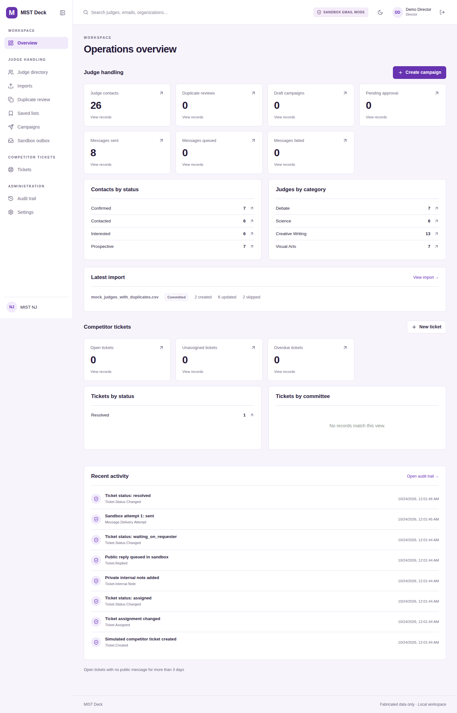

# MIST Deck

A local prototype for MIST NJ organizers. Judge contacts, CSV imports, outreach,
and competitor support otherwise live in separate workflows, making duplicate
review, campaign approval, and follow-up difficult to track. MIST Deck brings
those workflows and their audit trail into one application.

**Project status:** working local prototype for evaluation. The MIST team has not
adopted it, and it has no real users or production deployment. The included
names, organizations, and addresses are fabricated. Campaign delivery writes
only to a local sandbox outbox; it does not send email.

The prototype currently supports role-based sign-in, a searchable judge directory,
CSV column mapping and duplicate merge review, saved lists, campaign preview and
approval, a PostgreSQL-backed sandbox worker, support tickets with private notes,
dashboard metrics, and an audit trail.

**SANDBOX EMAIL MODE: no real email can be sent.** The only provider is a database
mock. Addresses must use `example.com`, `example.org`, or `example.net`. There are
no SMTP credentials, email provider SDKs, domain lookups, or tracking pixels.

## Start locally

Prerequisite: Docker Desktop / Docker Engine with Compose v2.24.4 or newer.
From this repository, copy the configuration template and choose local-only
passwords for `POSTGRES_PASSWORD` and `SEED_PASSWORD` in `.env`:

```sh
cp .env.example .env
docker compose up --build -d
docker compose ps
```

Open **http://localhost:5180**. The API is at http://localhost:8008 and its generated
OpenAPI documentation is at http://localhost:8008/docs. Ports bind to loopback.
The API waits for PostgreSQL, applies committed Alembic migrations, then seeds an
empty database. The frontend and worker wait for a healthy API.

The first build downloads container images and dependencies. Subsequent builds
reuse their cache. Stop with `docker compose down`; the named database volume is
retained. No public deployment is configured.

## Development accounts

All four fabricated development accounts use the `SEED_PASSWORD` value in your
local `.env` file:

| Email | Role | Additional permissions |
| --- | --- | --- |
| `director@example.com` | Director | All application capabilities |
| `tech@example.com` | Technology Administrator | Imports, catalogs, job troubleshooting, audit; no private tickets |
| `competitions@example.com` | Competitions Administrator | `campaign_approver` |
| `support@example.com` | Support Staff | Assigned tickets only |

Passwords are stored as Argon2id hashes. Login creates a random, 12-hour HttpOnly,
SameSite=Strict cookie; only its SHA-256 digest is stored. Mutation requests require
an application-specific header and the API exposes no permissive CORS policy.
A director can change roles and optional grants under Settings → Users.

## Configuration

The local `.env` file is required and ignored by Git. Choose passwords without
URL-special characters for this Compose demo because the database URL is assembled
from `POSTGRES_PASSWORD`. Secrets are passed to services as environment variables.

| Variable | Default / purpose |
| --- | --- |
| `API_PORT` / `WEB_PORT` | `8008` / `5180`, loopback-only host ports |
| `POSTGRES_USER` | `mist` |
| `POSTGRES_PASSWORD` | Required local PostgreSQL password; set in `.env` |
| `POSTGRES_DB` | `mist` |
| `DATABASE_URL` | Required by Python when run outside Compose; Compose assembles it from the database variables |
| `SEED_PASSWORD` | Required local demo-account password; used only when seeding an empty database |
| `COOKIE_SECURE` | `false` for local HTTP; use `true` behind HTTPS |
| `IMPORT_MAX_BYTES` | `2097152` |
| `IMPORT_MAX_ROWS` | `5000` |

Changing `SEED_PASSWORD` does not reset already-created accounts. Changing database
credentials also does not modify an existing PostgreSQL volume.

## Migrations and seed

```sh
docker compose run --rm api alembic upgrade head
docker compose run --rm api python -m mist.seed
```

Seeding is idempotent when user records already exist. It creates four organizers,
shared categories and qualifications, committees, and 24 fabricated judge contacts.
No tickets or delivered messages are fabricated as metrics; create them through
the working workflows.

## Try the complete workflow

1. Sign in as `competitions@example.com`.
2. Open Imports → Import CSV and upload `sample-data/mock_judges_with_duplicates.csv`.
3. Inspect automatic column mapping. Use Analyze rows.
4. Review the six strong/possible duplicate rows. Choose field values and merge,
   keep separate, or skip. Low-confidence name-only suggestions never auto-merge.
5. Return to the import, continue to commit, check the confirmation, and commit.
   Invalid rows remain downloadable in the error CSV.
6. Filter Judge directory by **Arts**, then Save list.
7. Open the saved list and create a campaign. Preview each recipient, submit,
   approve, and queue. The seeded competitions account has the approval grant.
8. Watch separate messages appear in Sandbox outbox. No message has multiple
   recipients. The worker runs automatically.
9. Create a simulated ticket, choose a category, and assign Demo Support. Add an
   internal note and a public sandbox reply using their separate composers.
10. Resolve the ticket. Sign in as director to inspect the audit trail.

A director may cancel any nonterminal campaign, including queued/sending work;
remaining messages will not be delivered. Approvals and previews are immutable
once a campaign is created; compose a new draft to change content or recipients.

## Sample CSV expectations

`mock_judges.csv` has 24 unique records with multiple categories, qualifications,
historical years, statuses, and one do-not-contact contact. Those contacts already
exist after seeding, so importing this file again produces exact-email reviews.

`mock_judges_with_duplicates.csv` has these cases against the seed database:

| CSV line | Pattern | Expected outcome |
| --- | --- | --- |
| 2 | Capitalized judge01 email | Strong exact-email review |
| 3 | Whitespace around judge02 email | Strong exact-email review |
| 4 | judge03 with changed organization/title | Strong exact-email review; select incoming changed fields |
| 5 | Primary email equals judge04 alternate | Strong alternate-email review |
| 6 | judge05 name + organization, new email | Possible duplicate; human review |
| 7 | Spelling variation of judge06, same organization | Possible duplicate; human review |
| 8 | Same name as judge07, different organization and email | Name-only suggestion; create separately unless explicitly resolved otherwise |
| 9 | Invalid email | Invalid; skipped with downloadable error |
| 10 | No usable identity | Invalid; skipped with downloadable error |
| 11 | Novel fabricated contact | Ready to create |

Choosing merge for the first six cases yields **2 created, 6 updated, 2 skipped**.
The numbered fabricated names are intentionally similar, so additional name-only
suggestions can appear; they carry 35% confidence and never block commit. Their
explanations and resolutions remain stored after commit.

## Worker and deliberate failures

```sh
docker compose logs -f worker
docker compose exec worker python -m mist.worker --once
```

The second command drains currently available jobs. The normal worker also
handles scheduled retries. To test failures without racing the worker:

```sh
docker compose stop worker
```

Queue a campaign. As director or technology administrator, open a queued message
in Outbox and select **Enable failure simulation**. Then:

```sh
docker compose start worker
```

It will fail after three attempts. Disable simulation and choose Retry failed
message to start a new bounded attempt cycle, retaining the same idempotency key
and audit history. Automatic backoff is 2, 4 seconds before remaining attempts;
claims older than five minutes can be recovered. Worker health is served inside
its container on port 8001 at `/health`.

## Tests

Backend tests use a separate ephemeral PostgreSQL database named `mist_test` and
refuse to truncate a database without the `_test` suffix.

```sh
docker compose --profile test run --build --rm test
```

Frontend type check, production build, and component tests:

```sh
docker run --rm -v "$PWD/apps/web:/app" -v /app/node_modules -w /app node:22-alpine sh -c 'npm ci && npm run build && npm test'
```

Full browser scenario uses a separate Compose project and database volume:

```sh
./scripts/e2e.sh
```

The test-only app is at http://localhost:15173. Run all layers with
`./scripts/test.sh`. Browser traces/reports go under `apps/web/test-results` and
`apps/web/playwright-report`. The scenario exercises the complete CSV → duplicate
review → dynamic list → campaign approval → worker → outbox → ticket → audit flow.
The runner resets only its dedicated `mist_e2e` database before each run. It
requires both the exact database name and an explicit test-reset environment flag.
The main workspace database is never reset by these tests. Stop the test stack:

```sh
docker compose -p mist-deck-e2e -f docker-compose.yml -f docker-compose.e2e.yml down
```

## Local development without rebuilding the frontend

With Node 22 installed:

```sh
cd apps/web
npm ci
npm run dev
```

Vite proxies `/api` to `localhost:8008`. Vite uses port 5181 so it does not collide with the Compose app. Python source is shared by the API and worker through
the `mist` package under `apps/api`; do not duplicate models in `apps/worker`.

## Code map

- Frontend application and route screens: `apps/web/src/`.
- Frontend component and browser tests: `apps/web/src/workflows.test.tsx` and
  `apps/web/tests/full-workflow.spec.ts`.
- FastAPI routes, services, models, seed, and worker: `apps/api/mist/`.
- Backend tests and migrations: `apps/api/tests/` and `apps/api/migrations/`.
- Local orchestration: `docker-compose.yml`; fabricated import files: `sample-data/`.

## Architecture and limitations

- React + strict TypeScript, Vite, Router, TanStack Query, accessible semantic
  controls, and React Hook Form/Zod for sign-in; API schemas validate every write.
- FastAPI + SQLAlchemy 2 + Pydantic + PostgreSQL JSONB and Alembic.
- PostgreSQL queue uses atomic `FOR UPDATE SKIP LOCKED` claims and transactionally
  committed mock receipts; no Redis.
- Database-backed metrics follow the current user's record visibility. Overdue
  means an open ticket has had no public message for more than three days.
- The application is an MVP for local testing: no password-reset/SSO, production
  account provisioning, attachment processing, rich-text editor, or real email.
- Imports accept UTF-8 only; other encodings produce a clear conversion request.
- The match engine is deterministic and bounded by import size, but compares rows
  against the active directory in memory. Very large deployments need indexed
  candidate generation. Directory/list views use paginated queries and batched
  relation fetches, not one query per displayed judge.
- Catalog selectors show up to 100 entries; table views are paginated. Qualification
  and category edits on contacts are additive to avoid silent history loss.
- Campaign drafts are immutable; correction uses a new draft. Approval can be
  performed by a permitted creator; separation of duties is not mandated in the
  prototype design.
- Private ticket content is not exposed to a technology administrator unless a
  director separately grants `private_tickets`. Ticket-linked outbox messages and
  audit snapshots honor this boundary.

See [architecture](docs/architecture.md), [data model](docs/data-model.md), and
[test plan](docs/test-plan.md) for transaction boundaries and verification details.

## Future Google Workspace integration

A future provider may implement the `EmailProvider` interface after a separate
security/design review. OAuth scopes, authenticated inbound webhook validation,
real-address authorization, retention, rate limiting, idempotent provider receipts,
and reconciliation would need explicit production designs. This MVP contains no
Gmail OAuth, API transport, SMTP path, or synchronization job. Mock delivery is
not evidence of external deliverability.

## Verified local build

The final run passed **25 backend tests, 7 frontend tests, and the full Playwright
scenario**, plus TypeScript compilation, Docker startup and Alembic consistency.
See [validation details](docs/validation.md) and the
[requirements map](docs/requirements-matrix.md).



[View the tablet layout](docs/screenshots/tablet.png)
