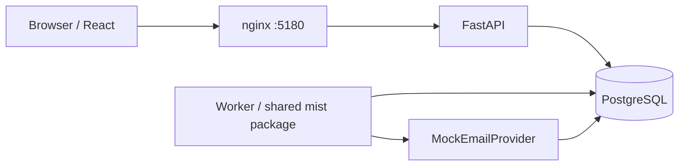

# MIST Deck architecture

Local React/Vite client → same-origin nginx proxy → FastAPI → PostgreSQL.
The independent Python worker claims PostgreSQL jobs and records mock delivery.
There is no external email transport and no recipient-domain lookup.

The requested application stack is used directly. Sites hosting and Canvas are
not used: this is an explicitly local Docker/PostgreSQL application, not a hosted
Site or an inline visualization.

## Milestone record

1. Foundation: relational models, server-side roles, Argon2 password hashing,
   opaque cookie sessions, migration infrastructure, Docker services and seed data.

## Deliberate design decisions

- Optional grants are a JSONB array on users rather than separate permission tables.
- Merge tombstones retain immutable campaign history. Contact merges union
  qualifications, categories, notes and engagements; snapshots preserve every
  original scalar. Additional email addresses are kept in `preserved_emails`.
- The sandbox allowlist applies in every environment, stronger than development-only.
- Email and ticket bodies are plain text, stripped of HTML on input and rendered
  as React text. No user-controlled HTML is injected.
- Local Compose defaults are development-only credentials. Environment variables
  supply database credentials and the seed password; `.env` is ignored.

## Components and flows

The frontend uses TanStack Query for cache invalidation after mutations and polling
for campaign/outbox status. Filter state is in route query parameters. Plain-text
content is sanitized with Bleach before storage and escaped by React on rendering.
The UI uses semantic labels, native selects, checkbox confirmations and modal
`dialog` focus containment; it has explicit loading, empty, error and denied states.
The custom palette, original layout, typography, and icons use no ServiceNow assets.

Catalog APIs are consolidated under `/api/catalogs/{categories|qualifications|committees}`
instead of three separate suggested route groups. All other major workflow groups
follow the supplied API structure. Mutation inputs are strict Pydantic schemas;
outputs use explicit serialization, public record schemas and a common pagination
envelope. Password hashes and session digests are always excluded.

### Campaign lifecycle

Draft → pending approval → approved → queued → sending → completed/partially failed.
A permitted approver may cancel any nonterminal campaign, including queued work.
This is a deliberate extension of the diagram's early-cancellation path to satisfy
the requirement to prevent unsent messages from a cancelled campaign.

Composition normalizes/deduplicates recipients, excludes suppression and invalid
addresses, validates template variables, and freezes one preview per recipient.
Queueing rechecks suppression. Delivery rechecks it again, because a contact can
opt out after approval. A mock provider cannot send a real message in any mode.

### Transaction boundaries

- Every HTTP mutation commits records and audit events together.
- Imports lock their batch row. Commit uses an advisory transaction lock shared
  with manual judge writes, then per-row savepoints. A second commit returns the
  existing summary. Mapping cannot change after analysis.
- Contact merges lock IDs in stable order and retain source records/snapshots.
- Approval, queue creation, cancellation, retry and delivery serialize on the
  campaign row. Cancellation and delivery use campaign-before-message lock order.
- Job claiming uses `FOR UPDATE SKIP LOCKED`, ordered by availability and ID, and
  commits ownership before delivery. Stale claims become eligible after 5 minutes.
- Delivery locks the campaign then the outbound row, verifies ownership and
  cancellation, and atomically writes receipt, recipient outcome and audit event.
  Since the mock provider only writes this same transaction, a crash cannot create
  an external side effect. A future network provider would require reconciliation.
- Delivery failures retry at most three times per cycle with exponential delay.
  Admin retry creates an audited new bounded cycle on the same message/key.
- Ticket number allocation uses a PostgreSQL sequence, so concurrent creation
  cannot collide. Gaps after rolled-back creation are expected.
- Public replies lock the ticket, use a client-generated UUID idempotency key,
  append a message and queue its sandbox outbound record atomically. Private notes
  write only to the internal-note table and audit log, never the outbound queue.

### Authorization

All routes enforce server-side role/grant checks. Support staff can access only
assigned tickets. Competitions administrators see tickets with a competition
category, assigned to the Competitions committee, assigned to themselves, or
created by themselves. Technology administrators do not receive ticket access by
role: a director must grant `private_tickets` separately. This restriction covers
ticket-linked outbox records, dashboard data and ticket audit snapshots.

Directors manage roles. The optional `campaign_approver` grant permits competition
campaign approval. Seeded competitions users have the grant so the supplied E2E
journey can be completed. A director cannot disable/demote their own account.

### Operational details

Compose health checks verify PostgreSQL, API database access, frontend HTTP, and
worker heartbeat. API request logs contain method/path/status/duration; worker
logs identify message IDs, status and attempt counts without email body contents.
The API host port defaults to 8008 because 8000 was already occupied on the build
machine. The web port defaults to 5180 because 5173 is also occupied. Container service addressing remains `api:8000`.

The initial schema is a generated, committed Alembic revision with explicit table,
index and constraint operations, plus a ticket-number sequence. No runtime
`create_all` path substitutes for migrations. Test databases are isolated.

### Scope decisions

- Content uses plain text rather than rich HTML. This avoids unsafe HTML rendering
  while still supporting multiline personalized messages.
- Contact qualification/category edits are additive; existing historical data is
  not silently deleted. Catalog records can be deactivated instead of deleted.
- Draft content is immutable after creation; compose a new draft to correct it.
- Overdue tickets use a documented three-day inactivity threshold, not a separate
  SLA scheduling subsystem.
- Native accessible controls form the small component system. React Hook Form/Zod
  handles sign-in, while other forms use native constraints plus API validation.
- Bounded catalog selectors load 100 records; their management tables paginate.
- The implementation milestones were integrated in a continuous local build;
  foundation and workflow tests ran as each backend slice became executable,
  followed by the combined UI build and full end-to-end validation.

## Completed milestone coverage

1. Foundation, PostgreSQL migration, authentication, roles, seed data and app shell.
2. Judge directory/detail, filtering, bulk tags/statuses, catalogs and history.
3. CSV upload/mapping/analysis/review/commit/reporting, including within-batch matches.
4. Dynamic lists, campaign preview/approval, queue/worker/mock provider and outbox.
5. Ticket assignment, categorized conversations, private notes, public replies and lifecycle.
6. Database dashboard, scoped audit/export, indexes, system health and error states.
7. Automated backend/frontend/browser tests, Docker startup, documentation and visual QA.

The final suite and migration consistency check passed. See validation.md for
exact results and requirements-matrix.md for the implementation map.
