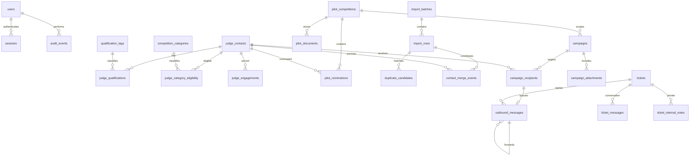

# Data model

All entity records use UUID primary keys and timezone-aware UTC created/updated
timestamps. HTTP serialization uses ISO 8601; the browser displays local time.
Normalized email fields and filter/sort fields have database indexes. JSON values
use PostgreSQL JSONB. Association tables use composite primary keys.

## Identity and duplicate matching

Email normalization trims whitespace and lowercases. Dots and `+tag` aliases are
never removed. Addresses are syntactically checked without DNS/network requests.
Contact records may use real domains; general campaigns and ticket replies require
reserved example domains. Pilot campaigns still write only mock receipts.
Name/organization comparison applies
Unicode NFKC and case folding, replaces punctuation with spaces, and collapses
whitespace. Displayed values preserve punctuation and case.

Ordered deterministic levels:

1. Primary email match: 1.00 confidence.
2. Primary/alternate/preserved address overlap: 0.98.
3. Normalized full name and nonempty organization match: 0.85.
4. Name similarity at least 0.82 with matching nonempty organization: 0.72.
5. Similar name alone: 0.35, advisory only.

Each candidate stores its type, explanation, score, incoming row, and existing
contact or earlier import row. No match auto-merges. Strong/possible matches
block commit until explicitly resolved. Advisory name-only matches may be kept
separate by committing; that choice is stored as `kept_separate`.

## Merge semantics

Scalar decisions select existing/incoming values. Missing existing values may be
filled from incoming data. Unique qualification/category names, years and notes
are combined. Do-not-contact uses logical OR to preserve suppression. Every
primary/alternate address is kept in the two displayed fields or preserved-email
array. All original scalar alternatives remain in the complete before snapshot.

A merge event stores both input snapshots, the after snapshot, actor, timestamp,
source import row or prior judge, and per-field decisions. Existing-contact merges
retain the source record as a suppressed tombstone, reparent engagements, union
relationships and relationship notes, and keep historical campaign recipients
attached to their immutable source. Judge history includes retained source IDs;
subsequent merges reparent tombstones. Foreign keys prevent orphaned records.
Ticket requester identity is independent of judge contacts; there is no implicit
email-based ticket/contact link that could expose private content.

## Imports

Batches preserve filename, encoding/delimiter/headers/size, mapping, status and
summary counts. Rows retain original and normalized JSON plus line number,
validation errors and resolution. Invalid rows count as skipped at commit.
Per-row savepoints permit validation failures without losing other valid rows;
unexpected database errors roll back the batch rather than hiding corruption.

## Delivery

A campaign recipient is unique within a campaign by both judge ID and normalized
email. Outbound messages have a unique idempotency key, a unique optional campaign
recipient foreign key, and a unique mock receipt. A message contains one address,
not To/Cc/Bcc collections. Ticket reply request IDs form idempotency keys.

Each pilot nomination links one contact to one pilot with its own response and
last-contact date and written qualification reason. The optional rules and procedures documents are private
database records, limited to one of each kind per pilot. Pilot campaigns retain
their pilot ID, and selected recipients must belong to that pilot.

Campaign attachments are private database records linked to a campaign draft.
They become immutable when the campaign is submitted. The mock outbox exposes
their names and authenticated downloads alongside each recipient message.
Forwards reference the original outbox message, so they retain access to its
attachments while receiving a new idempotency key and mock receipt.

The competition workspace table also holds seeded permanent competitions.
Each record has a category slug and an `is_pilot` flag. Only pilots can be
soft-deleted; deletion records the actor and timestamp, preserves linked history,
and excludes the pilot from ordinary lists and detail requests.

## Retention

No destructive purge is exposed. Imports, merge snapshots, suppression flags,
audit events, tickets, pilot documents and mock messages stay in the local database volume. This
supports reproducible testing; it is not a production retention policy. Real-data
use would need separate deletion/anonymization, export, retention, backup and
access-review rules. Keep real personal data and private documents out of the
public repository; assess local data handling before use with real records.

Shared inbox additions: `campaign_recipients.judge_id` is optional, with a stable
recipient name/email snapshot for one-off recipients and retained history after
directory clearing. `inbound_messages` links known senders to judge conversations
and optionally to a competition/campaign; unknown senders link to tickets.
`notifications` stores shared read state and one failure alert per outbound message.
`directory_backups` retains the CSV and directory fingerprint used for a chair's
password-confirmed clear. Saved-list storage was removed.

Ticket assignment, committee, category and priority columns were removed in
`d61f3b9720ac`. Existing assigned tickets become waiting-on-organizer conversations;
tickets, public messages, notes and audit history remain. Support-staff accounts
are disabled and their sessions are revoked.

`e72a6c05f184` adds ticket context versions, private resolution summaries and
auto-close deadlines. `ticket_drafts` stores immutable chair-reviewed snapshots;
`ticket_actions` records idempotent atomic status/reply/note operations. Notifications
may target one user and one draft. Private notes record their kind and optional
request ID. Context changes supersede unconsumed approvals.
